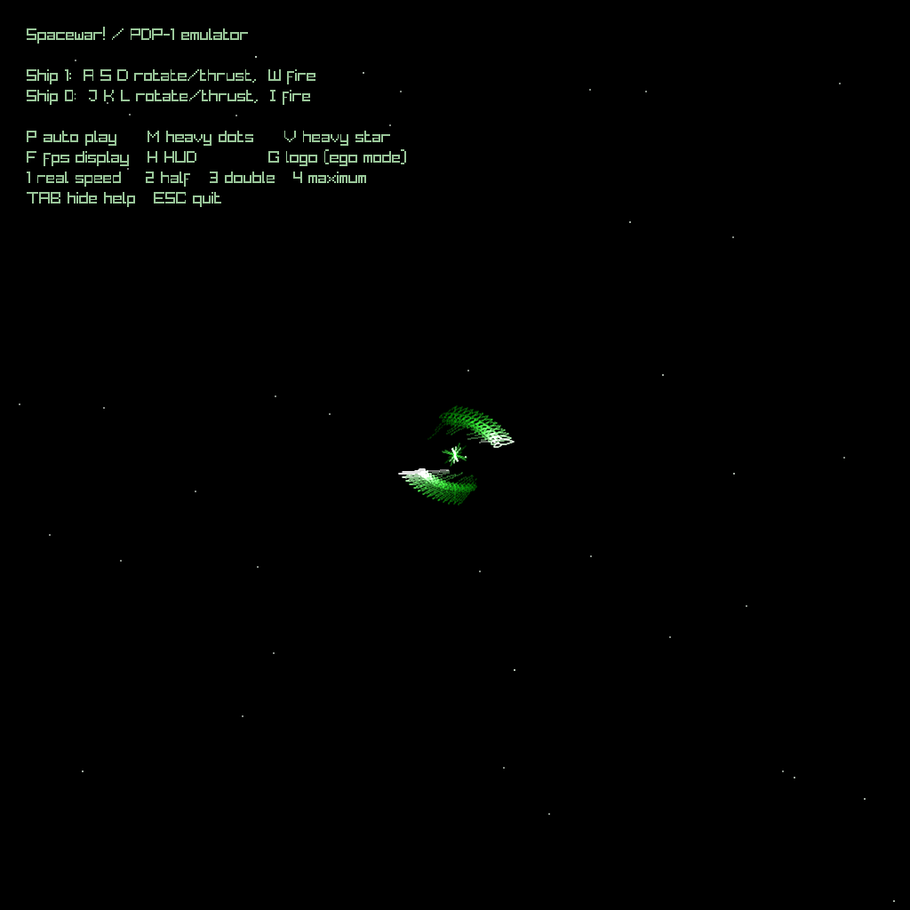

# Spacewar and PDP-1 demos

Some two decades or more ago, I happened to wander into Tom Duff's office
at Pixar on a particularly slow day, and asked him what he was working on.
He mentioned that he had discovered that you could get the original binary
files for the classic game [Spacewar!](https://en.wikipedia.org/wiki/Spacewar!)
that ran on the PDP-1.  He thought it would be fun to write an emulator for
that machine. 

I thought so to.  This is the one I tinkered together over the next few days.
I took it with me as a conversation starter at my first Hackers! conference.

This project emulates the PDP-1 display and runs Spacewar! alongside
three other PDP-1 programs: Minskytron, Snowflake, and Munching Squares.

I recently dusted off the code and revised it with GPT Luna.  It uncovered
a bug I had missed in the handling of the overflow bit that kept me from 
running the snowflake demo properly.  I also had Luna port it to using 
the raylib library instead of the old style OpenGL.



## Build

You need a C compiler, `make`, and [raylib](https://www.raylib.com/).
The Spacewar! program image, `spacewar.mem.h`, must also be present in
the project directory. It is generated data and is not tracked by git.
The Minskytron, Snowflake, and Munching Squares program images are
included in `demo_images.h`.

Build all four programs with `make`:

```sh
make
./spacewar
./minskytron
./snowflake
./munch
```

Run `make check` to check PDP-1 hardware multiplication, Snowflake's
centered display-coordinate coverage, and Munching Squares output and
Test Word behavior.

## Controls

All programs use `1` for real PDP-1 speed, `2` for half speed, `3` for
double speed, `4` for maximum speed, `TAB` to toggle help, and `ESC` to
quit.

### Spacewar!

- Ship 1: `A` / `D` rotate, `S` thrust, `W` fire.
- Ship 0: `J` / `L` rotate, `K` thrust, `I` fire.
- `P` toggles autopilot; `M` heavy dots; `V` heavy star;
  `F` FPS display; `H` HUD; `G` logo.

### Minskytron

Click the 18 Test Word switches to change the value, shown in octal.
DEC bit numbering is used: switch 0 is the leftmost and most
significant bit. Press `R` to restart; Minskytron reads the Test Word
when it starts.

### Snowflake

Click sense switches 1 and 2, or use `F1` and `F2`, to toggle them.
Switch 2 selects 8-dot mode; switches 1 and 2 together select
single-dot mode.

### Munching Squares

The demo runs a classic PDP-1 display loop. Click the Test Word switches
to change the increment used by the loop. A zero Test Word selects the
traditional octal increment `02345`.

## Program images

The Minskytron and Snowflake machine-code images in `demo_images.h`
were decoded from paper tapes. The Munching Squares image is based on
Jackson Wright's classic PDP-1 display program. Snowflake uses the
later PDP-1 hardware multiply option; Spacewar! uses the original step
multiply and divide instructions.

## Credits

`macro1.c` originated as Gary A. Messenbrink's MACRO8, was modified by
Bob Supnik for MACRO7 and MACRO1, and was substantially reworked by
Phil Budne. It is based on `pal` by Douglas Jones and Rich Coon.

— Mark
